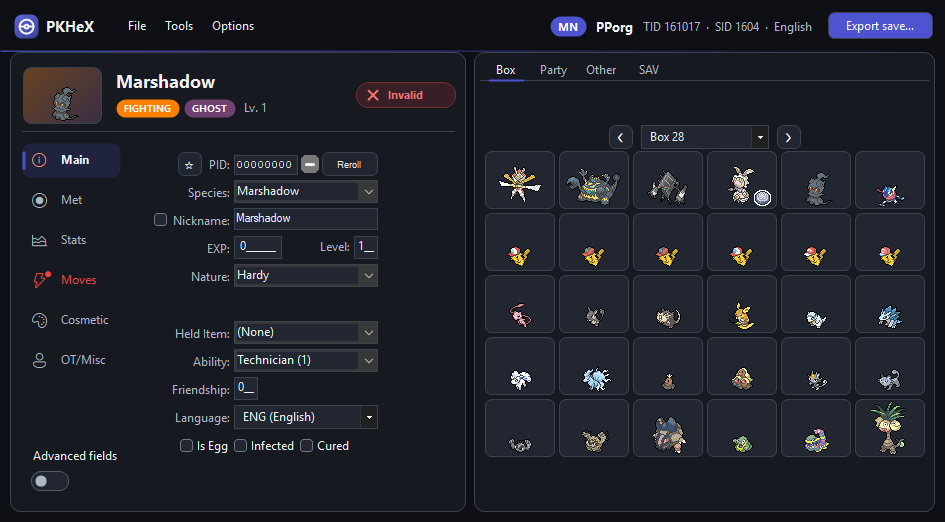
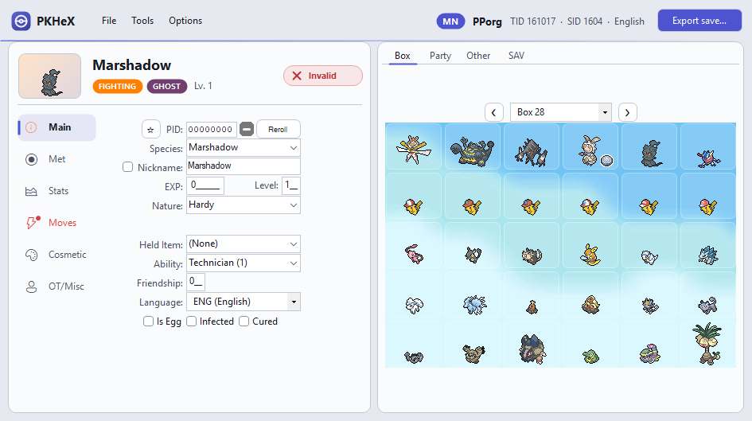
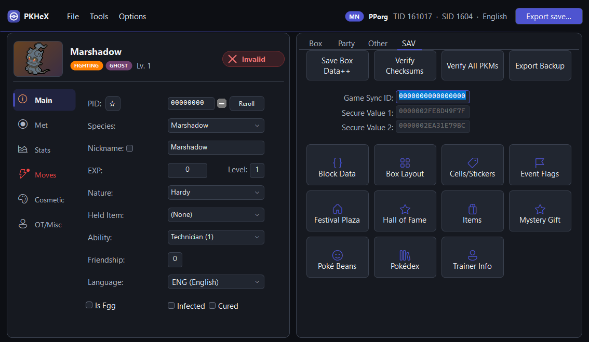
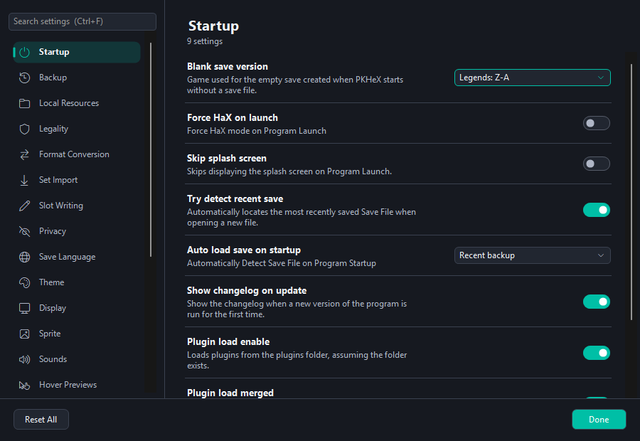
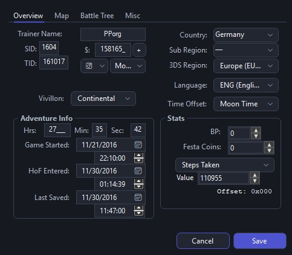
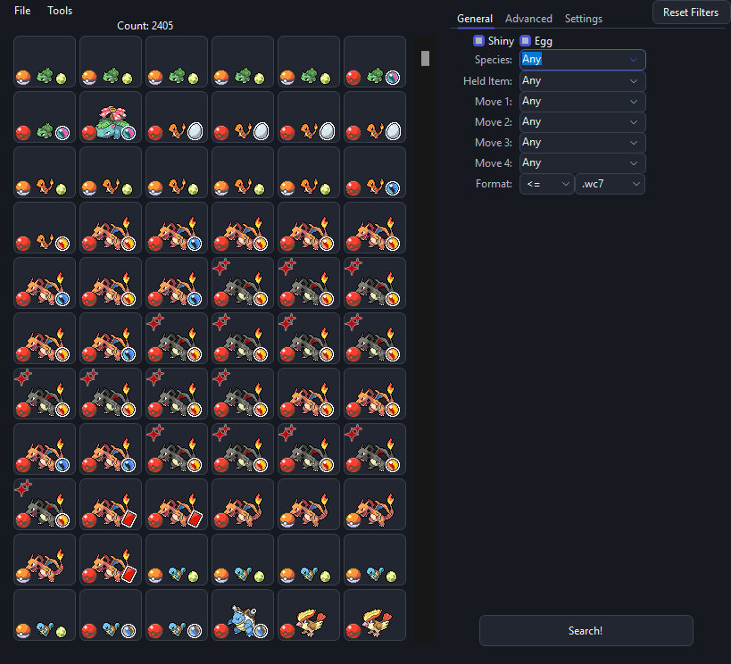

<div align="center">

# 🎨 PKHeXth — Modern UI

**PKHeX with a redesigned interface: calmer, easier to read, and easier to find your way around.**

[](https://github.com/AmarilloNL/PKHeXth/releases/latest)
[](#download)
[](LICENSE)

[**⬇️ Download**](https://github.com/AmarilloNL/PKHeXth/releases/latest) · [🖼️ Screenshots](#screenshots) · [✨ What's different](#whats-different) · [📂 Supported files](#supported-files)

</div>

A fork of [hexbyt3/PKHeXth](https://github.com/hexbyt3/PKHeXth) (itself a fork of
[kwsch/PKHeX](https://github.com/kwsch/PKHeX)). Same save editing engine, same bundled plugins.

<a id="download"></a>

## ⬇️ Download

Grab **PKHeX.exe** from the [**latest release**](https://github.com/AmarilloNL/PKHeXth/releases/latest).

> [!TIP]
> It's a single self-contained file for 64-bit Windows: no install and no .NET runtime needed.
> Put it in **its own folder** (it keeps its settings, backups and databases next to itself) and run it.

<a id="screenshots"></a>

## 🖼️ Screenshots



| ☀️ Light theme | 🧰 Save tools |
| --- | --- |
|  |  |

| ⚙️ Settings | 🪟 Sub-windows |
| --- | --- |
|  |  |

| 🎁 Mystery Gift Database |
| --- |
|  |

<a id="whats-different"></a>

## ✨ What's different

| | |
|---|---|
| 🏠 **Main window** | One app bar with the trainer summary, a Pokémon summary header, card-style panes and rounded box tiles |
| ⚙️ **Settings** | One searchable page (Ctrl+F) with plain-language rows instead of 20+ tabs of property grids |
| 🌓 **Everywhere** | Dark and light themes with an accent color from the loaded game, in every window and plugin |
| 🔧 **Fixes** | Auto-Legality *Legalize* crash fixed; no chime for the save that opens at startup |

> [!NOTE]
> Theme options live in **Options → Settings → Theme** (System / Light / Dark, accent source,
> custom accent color).

<details>
<summary><b>The full list of changes</b></summary>
<br>

**🏠 Main window**
- One app bar with the trainer summary and a clear **Open save file** / **Export save** button.
- Pokémon summary header: sprite, name, gender and shiny marks, type chips, level, and the legality badge.
- Editor and box panes drawn as cards; sidebar sections with icons, and a red dot on sections that contain invalid data.
- Box and party slots as rounded tiles, with box wallpapers shown through in light mode.
- Save editors on the SAV tab as labelled icon tiles instead of a wall of small buttons.

**⚙️ Settings**
- One searchable page (Ctrl+F) with a category sidebar instead of 20+ tabs of property grids.
- Every setting is a row with a plain-language title, its description, and a fitting control: switch, dropdown, number, or color.
- Theme changes apply as soon as Settings closes.
- The same page is used for the database windows' Settings tabs and for plugin settings windows such as Auto-Legality Mod's (with its own categories); plugins keep saving their settings as before.

**🌓 Everywhere** (including sub-windows and plugin windows)
- Dark and light themes with an accent color picked from the loaded game (or your own color).
- Flat underline tabs, rounded buttons, themed text, number, date and dropdown fields, rounded group boxes.
- Save / OK buttons stand out as the primary action in every dialog.
- Database windows (Pokémon, Encounter, Mystery Gift) use the same dark slot tiles as the main box view.
- The Windows title bar matches the app.

**🔧 Fixes**
- Auto-Legality's *Legalize* no longer crashes when its encounter priority list contains "None".
- No "save loaded" chime for the save that opens at startup.

</details>

<a id="supported-files"></a>

## 📂 Supported files

PKHeX is a Pokémon core series save editor, programmed in [C#](https://en.wikipedia.org/wiki/C_Sharp_%28programming_language%29). It supports:

* 💾 Save files ("main", \*.sav, \*.dsv, \*.dat, \*.gci, \*.bin)
* 🟪 GameCube Memory Card files (\*.raw, \*.bin) containing GC Pokémon savegames.
* 🐾 Individual Pokémon entity files (.pk\*, \*.ck3, \*.xk3, \*.pb7, \*.sk2, \*.bk4, \*.rk4)
* 🎁 Mystery Gift files (\*.pgt, \*.pcd, \*.pgf, .wc\*) including conversion to .pk\*
* 📲 Importing GO Park entities (\*.gp1) including conversion to .pb7
* 🎬 Importing teams from Decrypted 3DS Battle Videos
* 🔄 Transferring from one generation to another, converting formats along the way.

Pokémon Showdown sets and QR codes can be imported/exported to assist in sharing.

PKHeX expects save files that are not encrypted with console-specific keys. Use a savedata manager
to import and export savedata from the console ([Checkpoint](https://github.com/FlagBrew/Checkpoint),
save_manager, [JKSM](https://github.com/J-D-K/JKSM), or SaveDataFiler).

> [!IMPORTANT]
> **We do not support or condone cheating at the expense of others.** Do not use significantly
> hacked Pokémon in battle or in trades with those who are unaware hacked Pokémon are in use.

<details>
<summary><b>🛠️ Building</b></summary>
<br>

PKHeX is a Windows Forms application which requires [.NET 10.0](https://dotnet.microsoft.com/download/dotnet/10.0).

```
dotnet build PKHeX.WinForms/PKHeX.WinForms.csproj -c Release
```

To make the single-file download yourself: `dotnet publish PKHeX.WinForms/PKHeX.WinForms.csproj -c Release -r win-x64 -p:SelfContained=true -p:EnableCompressionInSingleFile=true`.

The executable can be built with any compiler that supports C# 13. It can also be opened in
[Visual Studio](https://visualstudio.microsoft.com/downloads/) via the .sln or .csproj file. Use the
Debug or Release configuration; there isn't any platform specific code to worry about.

</details>

## 🙏 Credits

- [kwsch](https://github.com/kwsch) and contributors for [PKHeX](https://github.com/kwsch/PKHeX).
- [hexbyt3](https://github.com/hexbyt3) for PKHeXth and the bundled plugins (Auto-Legality Mod, seed finders and others).

<details>
<summary><b>Dependencies</b></summary>
<br>

PKHeX's QR code generation code is taken from [QRCoder](https://github.com/codebude/QRCoder), which is licensed under [the MIT license](https://github.com/codebude/QRCoder/blob/master/LICENSE.txt).

PKHeX's shiny sprite collection is taken from [pokesprite](https://github.com/msikma/pokesprite), which is licensed under [the MIT license](https://github.com/msikma/pokesprite/blob/master/LICENSE).

PKHeX's Pokémon Legends: Arceus sprite collection is taken from the [National Pokédex - Icon Dex](https://www.deviantart.com/pikafan2000/art/National-Pokedex-Version-Delta-Icon-Dex-824897934) project and its abundance of collaborators and contributors.

</details>

<sub>Upstream README translations: <a href=".github/README-es.md">Español</a> / <a href=".github/README-fr.md">Français</a> / <a href=".github/README-de.md">Deutsch</a> / <a href=".github/README-it.md">Italiano</a> / <a href=".github/README-ko.md">한국어</a> / <a href=".github/README-zh-Hant.md">繁體中文</a> / <a href=".github/README-zh-Hans.md">简体中文</a></sub>
